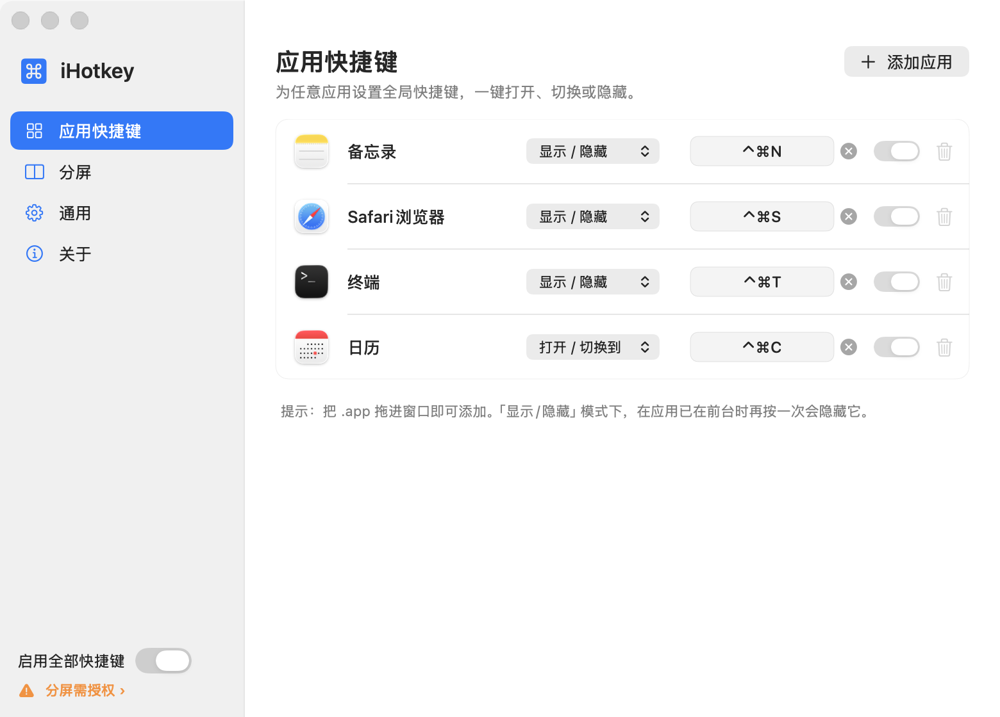
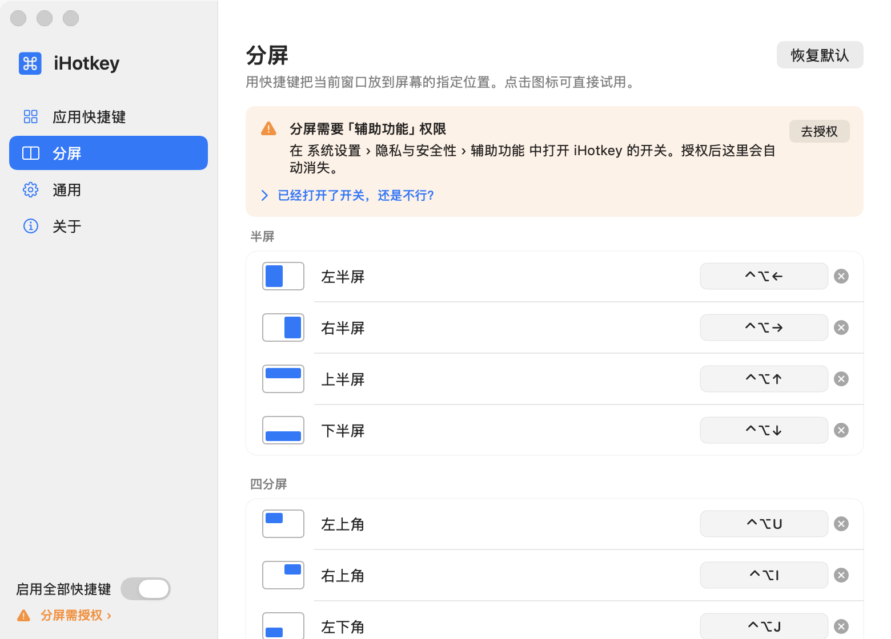

# iHotkey

**Your apps and windows, one shortcut away.**

[English](README.md) · [简体中文](README.zh-CN.md)

A native, open-source macOS menu bar app for launching apps and arranging windows. Built with Swift, SwiftUI and AppKit—no Electron, accounts or telemetry.

> **Release candidate:** `1.0.0-rc.1`. This repository is being prepared for its first public release. No published download or Apple-notarized build is currently claimed. Build locally using the instructions below, and review the [known issues](docs/KNOWN_ISSUES.md) before relying on it.

## What it does

- **App shortcuts:** assign a global shortcut to an app. Choose **Open / Focus**, or **Show / Hide** to hide it when it is already frontmost.
- **Window snapping:** 20 actions covering halves, quarters, thirds, two-thirds, maximize, almost maximize, maximize height, center, restore, and moving between displays.
- **Make it yours:** record shortcuts, adjust window gaps, and optionally cycle half-screen layouts through **½ → ⅔ → ⅓**.
- **Stay out of the way:** closing or minimizing the settings window keeps iHotkey in the menu bar. Pause hotkeys from the menu when needed.
- **Local preferences:** import and export JSON configuration; choose English, Simplified Chinese, or the system language.
- **Optional launch at login:** uses `SMAppService` on macOS 13+ and a LaunchAgent on macOS 12. Login behavior and migration still have [known limitations](docs/KNOWN_ISSUES.md).

| App shortcuts | Window snapping |
| --- | --- |
|  |  |

## Requirements and compatibility

- **App deployment target:** macOS 12 Monterey or later.
- **Build architectures:** Apple Silicon (`arm64`) and Intel (`x86_64`), packaged as a universal app.
- **Development:** Swift 6 / Xcode 16 or later, or a compatible Command Line Tools installation that includes Swift Testing. Python 3 is required by the packaging and compatibility audit scripts.

The deployment target is **not** a claim that every supported OS has been runtime-tested:

| Environment | Evidence available |
| --- | --- |
| macOS 26.6.2, Apple Silicon | Renamed candidate: 26 unit tests, hotkey registration/dispatch and window/menu lifecycle checks passed. Real snapping under the new identity still needs authorization and a fresh test. |
| macOS 12, 13, 14 and 15 | Deployment-target typechecking passed for both architectures using a current SDK. No runtime tests on those OS versions. |
| Intel hardware | No runtime validation. The local Apple Silicon host could not execute the Intel slice because Rosetta was unavailable. |

See the [renamed candidate validation](docs/testing/rename-validation.md) and [historical compatibility report](docs/testing/legacy-compatibility-report.md) for methods and limitations, and [known issues](docs/KNOWN_ISSUES.md) for release blockers. The report predates the rename; old artifact paths and identities are historical evidence, not proof of a new build. Multi-display behavior, login/reboot flows, clean-machine installation and upgrade migration still need real-world validation. No GitHub Actions or notarization run is asserted here.

## Build locally

From the repository root:

```bash
./scripts/test.sh
VERSION=1.0.0-rc.1 SIGN_IDENTITY=- ./scripts/build-app.sh
```

The build produces `dist/iHotkey.app` and `dist/iHotkey-1.0.0-rc.1.dmg`. The default local signing mode is **ad-hoc**; it is not Apple Developer ID signing or notarization. Building does not install the app.

To try your local build:

```bash
open dist/iHotkey.app
```

For regular use, copy the app to `/Applications` before granting permissions or enabling launch at login, and use one copy consistently. If you use a locally generated DMG, open it and drag iHotkey into Applications.

### Signing and macOS security

Ad-hoc signing can cause Accessibility permission to become stale after a rebuild. Optional stable local signing is available:

```bash
SIGN_MODE=local ./scripts/build-app.sh
```

This opts into `scripts/setup-signing.sh`, which creates a self-signed identity in a dedicated user keychain. A stable identity can help preserve permissions across rebuilds; it is **not** Apple trust or a guarantee that TCC permissions will survive every change. Do not share the keychain, private key or its password file.

Official distribution requires a Developer ID Application certificate and Apple notarization through `scripts/release.sh`. That path requires separately configured credentials and has not been verified as a completed release. See [release guide](docs/RELEASING.md).

If macOS blocks an app, establish where it came from before proceeding. For a trusted local build, use the system's **Open Anyway** flow if offered; the exact UI varies by macOS version. Do not disable Gatekeeper or remove quarantine attributes from unverified downloads.

## First steps

1. Open iHotkey from the menu bar.
2. In **App Shortcuts**, click **Add App** or drag a `.app` from Finder into the window.
3. Click the shortcut field and press your key combination. **Esc** cancels; **Delete** clears the binding. New app rows start recording automatically.
4. Choose **Open / Focus** or **Show / Hide** for each app.
5. In **Window Snap**, grant Accessibility permission and try a shortcut. Clicking an action glyph hides the settings window and applies the action to the window behind it.
6. In **General**, configure language, Dock icon behavior, configuration import/export, and optional launch at login.

Assigning a shortcut already used inside iHotkey moves it away from the previous action and shows a notice. Common reserved shortcuts are rejected, but other apps and system settings can still conflict. On macOS 15+, Option-only and Option–Shift combinations are restricted; include Control or Command instead.

## Permissions and privacy

| Feature | Permission |
| --- | --- |
| App shortcuts | No Accessibility or Input Monitoring permission required; uses Carbon `RegisterEventHotKey`. |
| Window snapping | Accessibility permission, to read and change the focused window's position and size. |
| Launch at login | Optional login-item registration; macOS may require approval. |

For Accessibility:

- **macOS 13+:** System Settings → Privacy & Security → Accessibility.
- **macOS 12:** System Preferences → Security & Privacy → Privacy → Accessibility.

Enable the copy of iHotkey you actually use. If the switch is on but snapping no longer works after rebuilding or moving the app, quit duplicate copies and remove/re-add the correct app in that pane. The in-app reset option also revokes the existing grant and requires approval again. As a targeted fallback:

```bash
tccutil reset Accessibility com.ihotkey.app
```

Then reopen the app and grant permission again. This command resets iHotkey's Accessibility grant; it is not a general repair command and does not migrate permissions from a previous app identity.

Configuration is stored locally at:

```text
~/Library/Application Support/iHotkey/config.json
```

The app has no account, analytics or application-level network service. Exported configuration can contain app names, bundle identifiers, local paths and shortcuts—review it before sharing. See [Security](SECURITY.md).

## Default window shortcuts

`⌃` Control · `⌥` Option · `⇧` Shift · `⌘` Command

| Action | Shortcut |
| --- | --- |
| Left / Right half | `⌃⌥←` / `⌃⌥→` |
| Top / Bottom half | `⌃⌥↑` / `⌃⌥↓` |
| Top-left / Top-right quarter | `⌃⌥U` / `⌃⌥I` |
| Bottom-left / Bottom-right quarter | `⌃⌥J` / `⌃⌥K` |
| First / Center / Last third | `⌃⌥D` / `⌃⌥F` / `⌃⌥G` |
| First / Last two-thirds | `⌃⌥E` / `⌃⌥T` |
| Maximize | `⌃⌥Return` |
| Almost maximize | Unassigned; record your own shortcut |
| Maximize height | `⌃⌥⇧↑` |
| Center | `⌃⌥C` |
| Restore | `⌃⌥Delete` |
| Next / Previous display | `⌃⌥⌘→` / `⌃⌥⌘←` |

Maximize resizes within the usable display area; it is not macOS full-screen mode. Some apps enforce minimum sizes or do not expose resizable windows. Restore is session-based, not a persistent window history; see the [known restore-error limitation](docs/KNOWN_ISSUES.md).

## Development and testing

Open `Package.swift` in Xcode, or use the repository scripts:

```bash
# Core unit tests (includes Command Line Tools Swift Testing setup)
./scripts/test.sh

# Audit an existing bundle and typecheck deployment targets
python3 scripts/compatibility-test.py --app dist/iHotkey.app

# Also exercise the UI and real TextEdit window snapping on this host
python3 scripts/compatibility-test.py --app dist/iHotkey.app --runtime --snap

# Runtime checks on another Mac; no Xcode or Python required
bash scripts/test-on-mac.sh /Applications/iHotkey.app
```

Runtime checks briefly close/reopen the tested app and focus a scratch TextEdit window. Snapping needs Accessibility approval. They do not test older operating systems by simulation, install Rosetta, reset permissions, or toggle login items. Review `PASS`, `FAIL` **and** `BLOCKED` results; a blocked check is not a pass.

`Sources/iHotkeyCore/` contains shortcut models, configuration, conflict detection and geometry without AppKit. `Sources/iHotkey/` contains the app lifecycle, global hotkeys, window control, app launching, system integration, diagnostics and SwiftUI views. Tests live in `Tests/iHotkeyCoreTests/`.

## Project information

- [Contributing](CONTRIBUTING.md) — development workflow and manual test expectations
- [Known issues](docs/KNOWN_ISSUES.md) — limitations and release readiness
- [Changelog](CHANGELOG.md) — release-candidate scope
- [Security](SECURITY.md) — safe vulnerability reporting and sensitive data
- [MIT License](LICENSE)
