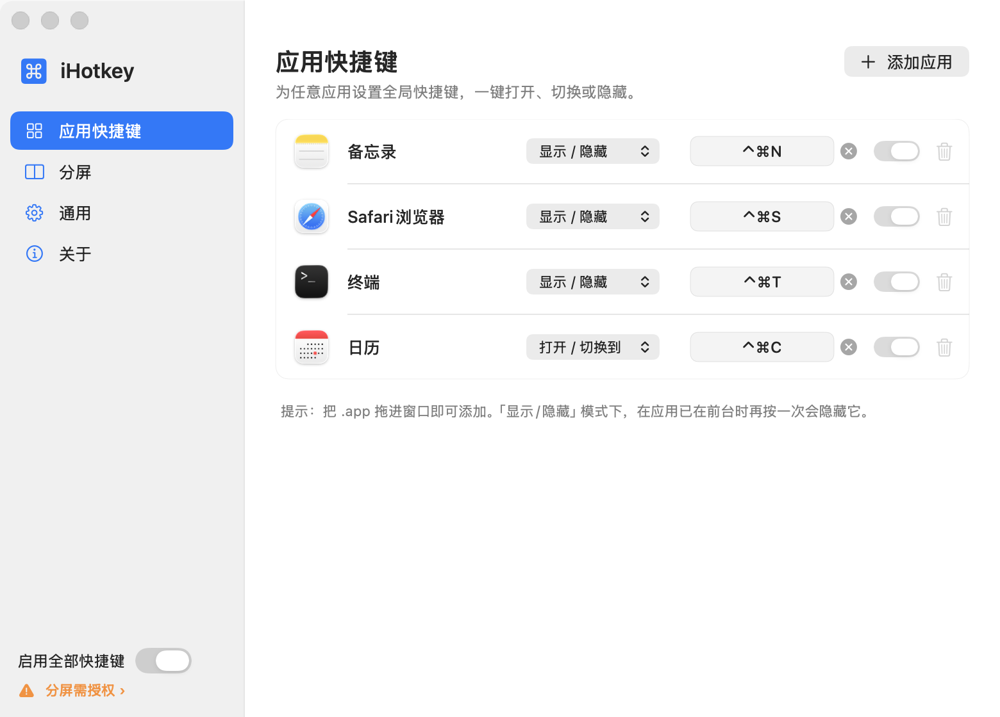
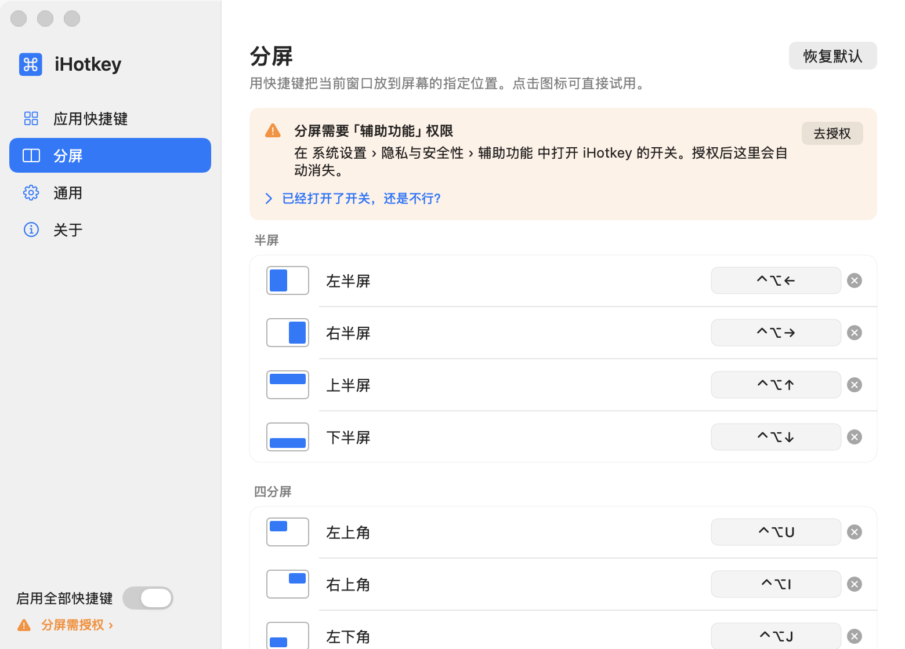

# iHotkey

**应用切换与窗口布局，一个快捷键就够。**

[English](README.md) · [简体中文](README.zh-CN.md)

iHotkey 是一款原生、开源的 macOS 菜单栏工具，用快捷键打开应用、切换焦点和整理窗口。使用 Swift、SwiftUI 与 AppKit 开发，无 Electron、无账号、无统计上报。

> **候选版本：`1.0.0-rc.1`。** 项目正在准备首次公开发布，目前不宣称已有公开下载或 Apple 公证版本。请按下文从源码构建，并在使用前查看[已知问题](docs/KNOWN_ISSUES.md)。

## 主要功能

- **应用快捷键：** 为应用设置全局快捷键，选择「打开 / 切换到」，或选择「显示 / 隐藏」——应用已在前台时，再按一次即可隐藏。
- **窗口分屏：** 提供 20 种动作，包括半屏、四分屏、三分屏、三分之二屏、最大化、几乎最大化、最大化高度、居中、恢复，以及移到其他显示器。
- **自由配置：** 直接录制快捷键、调整窗口间距，并可开启半屏快捷键的 **½ → ⅔ → ⅓** 连按循环。
- **常驻菜单栏：** 关闭或最小化设置窗口不会退出应用；需要时可在菜单中暂停快捷键。
- **本地配置：** 支持 JSON 导入与导出，界面语言可选简体中文、英文或跟随系统。
- **可选登录启动：** macOS 13+ 使用 `SMAppService`，macOS 12 使用 LaunchAgent。登录行为与旧登录项迁移仍有[已知限制](docs/KNOWN_ISSUES.md)。

| 应用快捷键 | 窗口分屏 |
| --- | --- |
|  |  |

## 系统要求与验证范围

- **应用部署目标：** macOS 12 Monterey 及以上。
- **构建架构：** Apple 芯片（`arm64`）与 Intel（`x86_64`），打包为通用应用。
- **开发环境：** Swift 6 / Xcode 16 及以上，或包含 Swift Testing 的兼容 Command Line Tools。打包与兼容性审计脚本需要 Python 3。

部署目标**不等于所有系统版本都已实测**：

| 环境 | 已有证据 |
| --- | --- |
| macOS 26.6.2，Apple 芯片 | 改名后的候选版本通过 26 项单元测试、热键注册/分发及窗口/菜单生命周期检查；新身份的真实分屏仍需授权后重新测试。 |
| macOS 12、13、14、15 | 使用当前 SDK 对两个架构的部署目标进行类型检查并通过；未运行这些旧系统。 |
| Intel 实机 | 未做运行验证。本地 Apple 芯片环境没有 Rosetta，无法执行 Intel 二进制。 |

本次结果见[改名构建验证](docs/testing/rename-validation.md)，历史方法与边界见[历史兼容性报告](docs/testing/legacy-compatibility-report.md)，发布阻塞项见[已知问题](docs/KNOWN_ISSUES.md)。报告早于本次改名，其中的旧产物路径和应用身份仅作为历史证据，不代表新构建已通过验证。多显示器、注销/登录、干净环境安装及升级迁移仍需真实环境测试；本文不宣称已执行 GitHub Actions 或完成公证。

## 从源码构建

在仓库根目录执行：

```bash
./scripts/test.sh
VERSION=1.0.0-rc.1 SIGN_IDENTITY=- ./scripts/build-app.sh
```

产物为 `dist/iHotkey.app` 与 `dist/iHotkey-1.0.0-rc.1.dmg`。默认本机构建使用 **ad-hoc 签名**，不等于 Apple Developer ID 签名或公证。构建过程不会安装应用。

体验本机构建：

```bash
open dist/iHotkey.app
```

长期使用时，建议先把应用复制到 `/Applications`，再授予权限或开启登录启动，并始终使用同一份应用。如使用本地生成的 DMG，打开后将 iHotkey 拖到「应用程序」。

### 签名与 macOS 安全提示

ad-hoc 签名可能导致重新构建后的辅助功能授权失效。可主动选择稳定的本机自签名模式：

```bash
SIGN_MODE=local ./scripts/build-app.sh
```

该模式通过 `scripts/setup-signing.sh` 在用户专用钥匙串中创建自签名身份。稳定签名有助于保留重新构建前的权限，但**不代表 Apple 信任，也不保证任何变动后都能保留 TCC 授权**。请勿分享钥匙串、私钥或其密码文件。

正式分发需要 Developer ID Application 证书，并通过 `scripts/release.sh` 提交 Apple 公证。此流程需要单独配置凭据，目前不宣称已完成验证或发布。详见[发布指南](docs/RELEASING.md)。

如果 macOS 阻止打开应用，请先确认来源。对于可信的本机构建，可在系统提供时使用「仍要打开」流程；不同系统版本的入口可能不同。不要关闭 Gatekeeper，也不要对未经核实的下载移除隔离属性。

## 开始使用

1. 从菜单栏打开 iHotkey。
2. 在「应用快捷键」中点击「添加应用」，或从访达拖入 `.app`。
3. 点击快捷键录制框，按下组合键。**Esc** 取消，**Delete** 清除。新增应用会自动进入录制状态。
4. 为各应用选择「打开 / 切换到」或「显示 / 隐藏」。
5. 在「分屏」中授予辅助功能权限，再试用快捷键。点击动作图标会收起设置窗口，并对后面的窗口执行动作。
6. 在「通用」中设置语言、Dock 图标、配置导入/导出，以及可选的登录启动。

如果新快捷键已被 iHotkey 内的其他动作使用，旧动作上的绑定会被移除，并显示提示。应用会拒绝常见系统保留快捷键，但仍可能与其他应用或系统设置冲突。macOS 15+ 对仅含 Option 或 Option–Shift 的组合有限制，建议加入 Control 或 Command。

## 权限与隐私

| 功能 | 所需权限 |
| --- | --- |
| 应用快捷键 | 无需辅助功能或输入监控权限；使用 Carbon `RegisterEventHotKey`。 |
| 窗口分屏 | 需要辅助功能权限，以读取并调整当前窗口的位置和大小。 |
| 登录启动 | 用户主动开启后注册登录项，macOS 可能要求额外批准。 |

辅助功能权限入口：

- **macOS 13+：** 系统设置 → 隐私与安全性 → 辅助功能。
- **macOS 12：** 系统偏好设置 → 安全性与隐私 → 隐私 → 辅助功能。

请为实际运行的那份 iHotkey 授权。重新构建或移动应用后，如果开关已打开但分屏无效，先退出其他副本，再在该面板移除并重新添加正确的应用。应用内的重置操作也会撤销原有授权，需要重新批准。必要时可针对 iHotkey 执行：

```bash
tccutil reset Accessibility com.ihotkey.app
```

然后重新打开应用并授权。该命令只用于重置 iHotkey 的辅助功能授权，不是通用修复命令，也不会迁移旧应用身份的权限。

配置保存在本机：

```text
~/Library/Application Support/iHotkey/config.json
```

应用没有账号、分析上报或应用层网络服务。导出的配置可能包含应用名称、Bundle ID、本地路径和快捷键，分享前请检查。安全说明见 [SECURITY.md](SECURITY.md)。

## 默认窗口快捷键

`⌃` Control · `⌥` Option · `⇧` Shift · `⌘` Command

| 动作 | 快捷键 |
| --- | --- |
| 左 / 右半屏 | `⌃⌥←` / `⌃⌥→` |
| 上 / 下半屏 | `⌃⌥↑` / `⌃⌥↓` |
| 左上 / 右上角 | `⌃⌥U` / `⌃⌥I` |
| 左下 / 右下角 | `⌃⌥J` / `⌃⌥K` |
| 左 / 中 / 右三分之一 | `⌃⌥D` / `⌃⌥F` / `⌃⌥G` |
| 左 / 右三分之二 | `⌃⌥E` / `⌃⌥T` |
| 最大化 | `⌃⌥Return` |
| 几乎最大化 | 默认未绑定，可自行录制 |
| 最大化高度 | `⌃⌥⇧↑` |
| 居中 | `⌃⌥C` |
| 恢复原大小 | `⌃⌥Delete` |
| 下一个 / 上一个显示器 | `⌃⌥⌘→` / `⌃⌥⌘←` |

「最大化」是在显示器可用区域内调整窗口，不是 macOS 全屏模式。有些应用限制最小尺寸，或不提供可调整大小的窗口。「恢复」依赖当前运行期间的记录，不是持久化窗口历史；其[错误处理仍有已知限制](docs/KNOWN_ISSUES.md)。

## 开发与测试

可在 Xcode 中打开 `Package.swift`，也可使用仓库脚本：

```bash
# 核心单元测试，兼容 Command Line Tools 的 Swift Testing 路径
./scripts/test.sh

# 审计现有应用包，并检查各部署目标
python3 scripts/compatibility-test.py --app dist/iHotkey.app

# 同时在当前系统执行界面与真实 TextEdit 分屏检查
python3 scripts/compatibility-test.py --app dist/iHotkey.app --runtime --snap

# 在另一台 Mac 上检查运行行为；无需 Xcode 或 Python
bash scripts/test-on-mac.sh /Applications/iHotkey.app
```

运行检查会短暂关闭/重新打开被测应用，并聚焦一个临时 TextEdit 窗口；分屏检查需要辅助功能权限。脚本不会模拟运行旧 macOS、安装 Rosetta、重置授权或切换登录项。请同时查看 `PASS`、`FAIL` 和 `BLOCKED`；被阻塞的检查不算通过。

`Sources/iHotkeyCore/` 存放快捷键模型、配置、冲突检测与几何逻辑，不依赖 AppKit。`Sources/iHotkey/` 存放应用生命周期、全局快捷键、窗口控制、应用启动、系统集成、诊断与 SwiftUI 界面。测试位于 `Tests/iHotkeyCoreTests/`。

## 项目信息

- [贡献指南](CONTRIBUTING.md)：开发流程与人工验收要求
- [已知问题](docs/KNOWN_ISSUES.md)：限制与发布准备情况
- [更新日志](CHANGELOG.md)：候选版本范围
- [安全说明](SECURITY.md)：漏洞报告与敏感信息处理
- [MIT 许可证](LICENSE)
